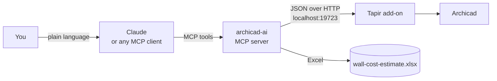

<div align="center">

# Archicad AI Productivity Tools

**Use plain language to ask an AI to correct fire ratings and estimate wall costs in Archicad.**

This software connection, called an MCP server, links Claude (or any MCP client) to Archicad through the free [Tapir](https://github.com/ENZYME-APD/tapir-archicad-automation) add-on.
Created for the **Nemetschek Design AI Productivity Challenge 2027**.


[▶ Demo: Claude Code](https://github.com/vietcad-com/archicad-ai-productivity/releases/download/v1.0.0/archicad-ai-demo.mp4) · [▶ Demo: Claude Desktop app](https://github.com/vietcad-com/archicad-ai-productivity/releases/download/v1.0.0/archicad-ai-demo-claude-desktop.mp4) · [Install](INSTALL.md) · [One-page summary](docs/summary.pdf)

</div>

---

## What it does

| | Task | Before | With the AI |
|---|---|---|---|
| 🚪 | **Fire ratings.** Find every door with an empty Fire Rating. Check door types and the walls that contain them, then apply a rule to all of them at once. | Open each door's settings, storey by storey | One conversation, 75 s in the demo |
| 🧱 | **Wall cost estimate.** Measure every wall by type. Use your rates to produce low / mid / high estimates in Excel. | Manual take-off and spreadsheet work | One request, a few seconds of processing |

On the Villa Patio sample project (3 storeys, 387 walls, 24 doors), finding and checking all 24 doors takes **0.2 s**.
Applying the ratings takes **0.5 s**. Measuring all 387 walls takes **1 s**, and pricing them takes **0.6 s**. The remaining time is spent in conversation with the AI.

## How changes are controlled

The software enforces these rules. They do not depend only on instructions given to the AI:

- **Preview before every change.** Tapir's `dryRun` checks proposed changes first. The AI shows *old → new* values for every door and receives a token that can be used once.
- **Your approval is required.** Only `apply_property_update(token)` can apply changes. It applies exactly what you previewed. Each token works once.
- **Only property values change.** Nothing is created, moved or deleted. You can reverse the whole batch with a single **Edit › Undo** step.
- **Wall costing is read-only.** It measures walls without editing them.
- **Names are checked.** Before using words such as "fire rating" or "ground floor", `ResolveNames` checks them against the project.

## How it works



| Tool | Step | Changes the model? |
|---|---|---|
| `project_overview` | List storeys with door and wall counts | No |
| `resolve_names` | Check the user's words against names in the project | No |
| `find_doors_missing_property` | **Find**: list doors with an empty Fire Rating, by storey | No |
| `inspect_doors` | **Check**: inspect door type and size, plus the host wall's type, thickness and rating | No |
| `show_in_archicad` | Highlight elements and zoom to them (red = to fix, green = fixed) | No (display only) |
| `preview_property_update` | **Preview**: check proposed changes without applying them, show old → new values and return a token | No |
| `apply_property_update` | **Fix**: apply exactly the previewed changes, then count again | Property values only |
| `wall_takeoff` | Measure length, height, net/gross area and volume by wall type | No |
| `price_walls` | Calculate low/mid/high costs by wall type and export to Excel with assumptions | No |

## Quick start

```bash
# 1. Install Tapir in Archicad (Add-On Manager), open a project
# 2. Get the server
git clone https://github.com/vietcad-com/archicad-ai-productivity
cd archicad-ai-productivity && uv sync
# 3. Connect Claude Code
claude mcp add archicad -- uv --directory "$(pwd)" run nemetschek-ai
```

Then ask:

> Which doors have no fire rating, per storey? Show them to me in red, check their door types and host walls and propose a rule. Don't change anything yet.

> Price every wall by type. 300 mm walls 46 USD/m², 150 mm 28, glass 180/220/260. Net area, ±15 %. Export to Excel.

See [INSTALL.md](INSTALL.md) for full setup instructions, including Claude Desktop.

## Reproduce the demo

[`demo/demo.py`](demo/demo.py) runs the demo video's four prompts in real Claude Code sessions using the open project. It records the screen with ffmpeg.

## Project layout

```
src/nemetschek_ai/
  ac.py        Archicad JSON API + Tapir client (port discovery, helpers)
  server.py    MCP server: tools, safety rules, Excel export
demo/demo.py   scripted demo run + screen recording
docs/          one-page summary, demo GIF
```

## Credits

- [Tapir](https://github.com/ENZYME-APD/tapir-archicad-automation) by ENZYME APD and contributors: the Archicad add-on used by these tools.
- [Model Context Protocol](https://modelcontextprotocol.io) Python SDK.
- Villa Patio sample project © Graphisoft / enzyme apd.

Made by [VietCAD](https://vietcad.com), a Nemetschek partner in Vietnam. Available under the MIT licence.
