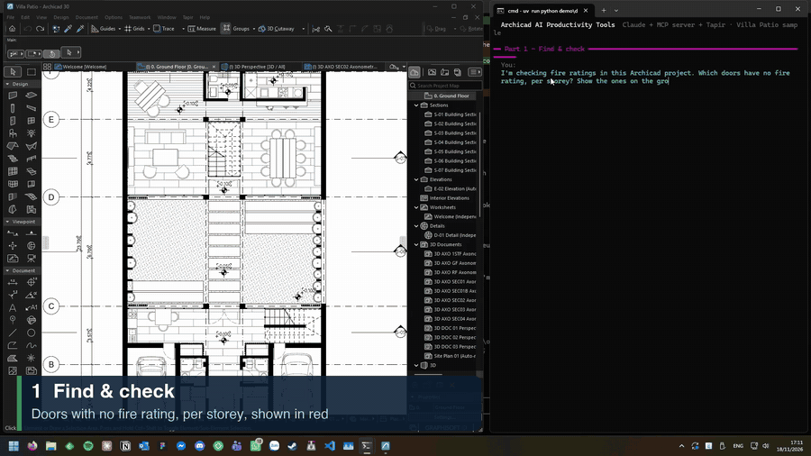
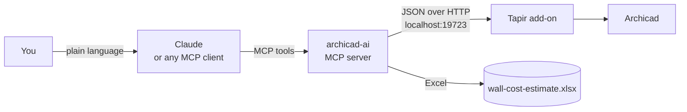

<div align="center">

# Archicad AI Productivity Tools

**Ask an AI to fix your model's fire ratings and price your walls, in plain language, in Archicad.**

An MCP server that connects Claude (or any MCP client) to Archicad through the free [Tapir](https://github.com/ENZYME-APD/tapir-archicad-automation) add-on.
Built for the **Nemetschek Design AI Productivity Challenge 2027**.




[▶ Watch the 3-minute demo](https://github.com/vietcad-com/archicad-ai-productivity/releases/latest) · [Install](INSTALL.md) · [One-page summary](docs/summary.pdf)

</div>

---

## What it does

| | Task | Before | With the AI |
|---|---|---|---|
| 🚪 | **Fire ratings.** Find every door with an empty Fire Rating, check door types and host walls, apply a rule in one batch. | Open each door's settings, storey by storey | One conversation, about 1 minute |
| 🧱 | **Wall cost estimate.** Measure every wall by type and price it with your rates, low / mid / high, in Excel. | Manual take-off and spreadsheet work | One prompt, a few seconds of compute |

On the Villa Patio sample project (3 storeys, 387 walls, 24 doors): finding and checking all 24 doors takes **0.2 s**,
the batch write **0.5 s**, measuring all 387 walls **1 s** and pricing them **0.6 s**. The rest of the time is the conversation.

## Safe by design

The rules are enforced in code, not only in the prompt:

- **Preview before every change.** Writes go through Tapir's `dryRun` first. The AI shows *old → new* for every door and gets a one-time token.
- **Nothing is written without your OK.** Only `apply_property_update(token)` writes, and only exactly what was previewed. Each token works once.
- **Property values only.** Nothing is created, moved or deleted. The whole batch is a single **Edit › Undo** step.
- **Wall costing is read-only.** It measures, it never edits.
- **No guessed names.** Words like "fire rating" or "ground floor" are checked against the project with `ResolveNames` before use.

## How it works



| Tool | Step | Changes the model? |
|---|---|---|
| `project_overview` | Storeys with door and wall counts | No |
| `resolve_names` | Check the user's words against real project names | No |
| `find_doors_missing_property` | **Find**: doors with an empty Fire Rating, per storey | No |
| `inspect_doors` | **Check**: door type, size, host wall type, thickness and rating | No |
| `show_in_archicad` | Highlight and zoom to elements (red = to fix, green = fixed) | No (display only) |
| `preview_property_update` | **Preview**: dry run, old → new, returns a token | No |
| `apply_property_update` | **Fix**: write exactly the previewed plan, recount | Property values only |
| `wall_takeoff` | Length, height, net/gross area, volume per wall type | No |
| `price_walls` | Low/mid/high cost per wall type, Excel with assumptions | No |

## Quick start

```bash
# 1. Install Tapir in Archicad (Add-On Manager), open a project
# 2. Get the server
git clone https://github.com/vietcad-com/archicad-ai-productivity
cd archicad-ai-productivity && uv sync
# 3. Connect Claude Code
claude mcp add archicad -- uv --directory "$(pwd)" run nemetschek-ai
```

Then ask:

> Which doors have no fire rating, per storey? Show them to me in red, check their door types and host walls and propose a rule. Don't change anything yet.

> Price every wall by type. 300 mm walls 46 USD/m², 150 mm 28, glass 180/220/260. Net area, ±15 %. Export to Excel.

Full setup, including Claude Desktop, is in [INSTALL.md](INSTALL.md).

## Reproduce the demo

[`demo/demo.py`](demo/demo.py) runs the four prompts of the demo video as real Claude Code sessions against the open project and records the screen with ffmpeg.

## Project layout

```
src/nemetschek_ai/
  ac.py        Archicad JSON API + Tapir client (port discovery, helpers)
  server.py    MCP server: tools, safety rules, Excel export
demo/demo.py   scripted demo run + screen recording
docs/          one-page summary, demo GIF
```

## Credits

- [Tapir](https://github.com/ENZYME-APD/tapir-archicad-automation) by ENZYME APD and contributors: the Archicad add-on this builds on.
- [Model Context Protocol](https://modelcontextprotocol.io) Python SDK.
- Villa Patio sample project © Graphisoft / enzyme apd.

Made by [VietCAD](https://vietcad.com), a Nemetschek partner in Vietnam. MIT licensed.
